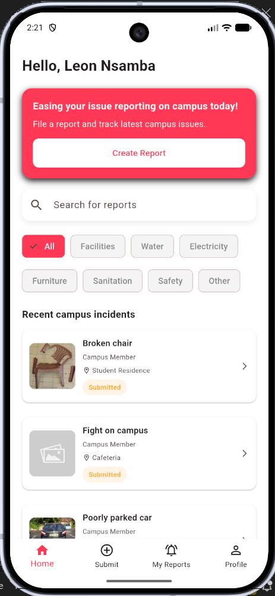
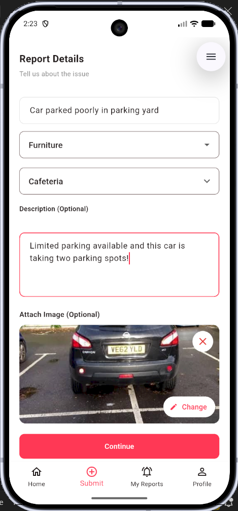
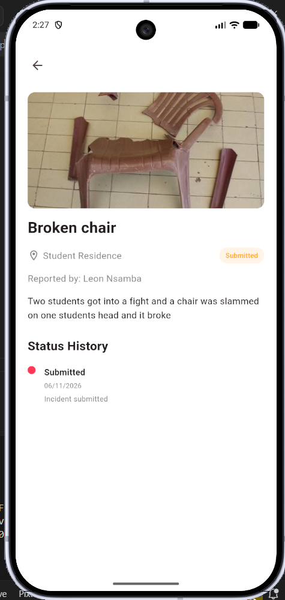
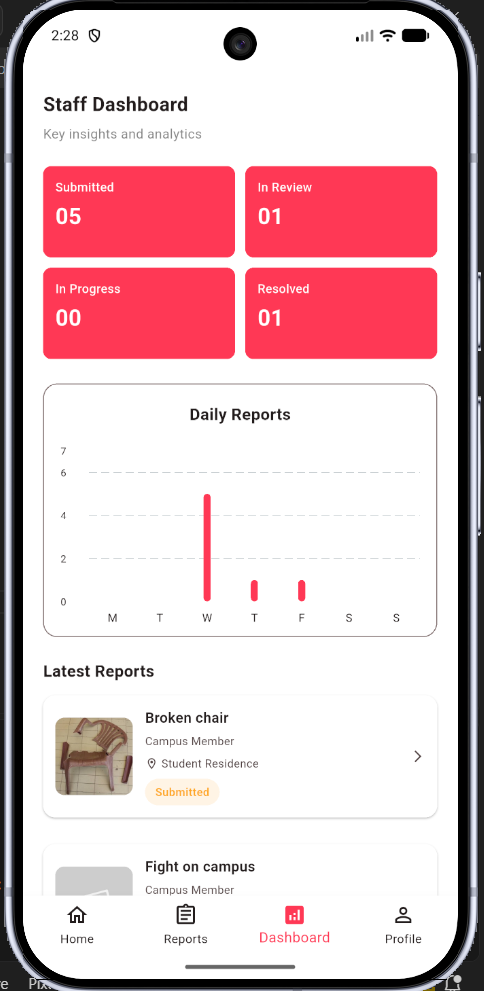
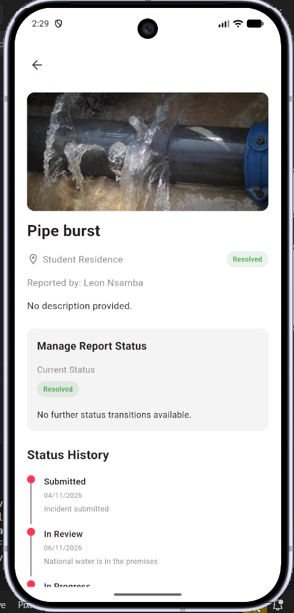
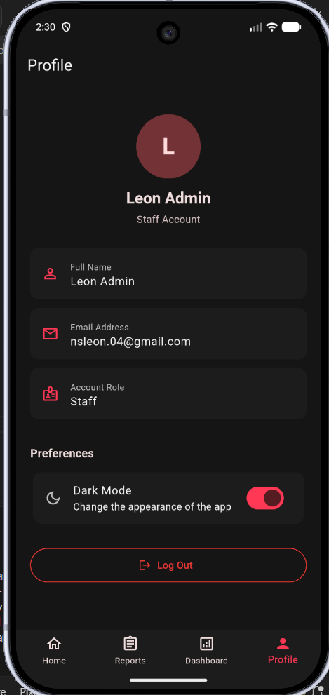

# Campus Incident Reporting App
A Flutter-based mobile application that provides a centralized platform for 
reporting, monitoring, and managing campus incidents.The application allows
ALU students to submit campus-related issues and track their progress, while
authorized staff can review the reports and update their resolution status

## Deliverables 
- [Demo Video](https://www.youtube.com/watch?v=NNqLf0ZZikA)
- [Architecture Diagram](https://drive.google.com/file/d/1fj8XnOmfxCnDX8ubzymQyuRIv3inVx2G/view?usp=sharing)
- [Entity Relationship Diagram](https://drive.google.com/file/d/1emuPZYwG6YVG9-V1RIO3wzmyT2n5OVM1/view?usp=sharing)
- [Figma Board](https://www.figma.com/design/nJUz4oafr3le4BSfclkuyN/campus-incident-reporting?node-id=0-1&t=ZUAaUngkp6EEourw-1)
- [Technical Report](https://docs.google.com/document/d/1ZiBDCOT0ZBD8L8hmxRuuI3Z-r3NYmbzdAj5gEIi-JE8/edit?tab=t.0)

## Technology Stack
| Technology | Purpose |
|---|---|
| Flutter | Mobile application development |
| Dart | Application programming language |
| Firebase Authentication | User authentication |
| Cloud Firestore | Application data storage |
| Cloudinary | Incident image hosting |
| Provider | State management |
| Shared Preferences | Local theme preference persistence |

## Application Screenshots
### Student Interface
<table align="center">
  <tr>
    <td></td>
    <td></td>  
    <td></td>    
  </tr>
</table>

### Staff Interface
<table align="center">
  <tr>
    <td></td>
    <td></td>  
    <td></td>    
  </tr>
</table>

## Incident Status Workflow
Reports progress through a sequential status lifecycle
<br>
**Submitted → In Review → In Progress → Resolved**
<br>
Students can monitor the status of their reports, while authorized staff
members manage status updates

## Project Structure
```
campus_reporting_app/  
  └── lib/                     
      ├── app/           # Routing and auth gate
      ├── core/          # Themes, preferences and text colors
      ├── models/        # Data blueprint
      ├── enum/          # Constant values
      ├── utils/         # Validation
      ├── providers/     # State management
      ├── services/      # Cloudinary and auth service logic
      ├── repositories/  # Firestone and database connection
      ├── screens/       # user screens
      |      ├── student/
      |      └── staff/
      └── widgets/       # Reusable widgets

```

## Getting Starting
### Prerequisites
- Flutter SDK
- Dart SDK
- Android studio or another supported Flutter development environment
- Firebase project configuration

## Installation
### Getting Started
### 1. Clone the Repository
```
    git clone https://github.com/L-nsamba/campus_incident_reporting_formative.git
    cd campus_incident_reporting_app
```
### 2. Install dependencies
```
    flutter pub get
```
### 3. Configure Firebase for your development environment
### 4. Run the application
```
    flutter run
```

## Authentication and Access Control
- Students register using their ALU email address
- Application navigation is determined by the authenticated user's role
- Access to staff operations is restricted through authorization control

## Future Improvements
- Push notifications for incident status updates
- More detailed reporting and analytics
- Additional incident management capabilities 


